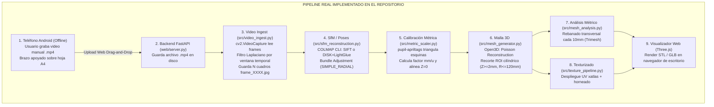

# AUDITORÍA TÉCNICA Y ARQUITECTÓNICA EXHAUSTIVA
**Proyecto:** Reconstructor Métrico 3D (Captura Monocular y Digitalización Anatómica de Miembros Superiores)  
**Rol Auditor:** Arquitecto Senior en Computer Vision, Fotogrametría, Mobile Web (Android/Chrome) y Geometría Multivista  
**Fecha:** Octubre 2026  
**Documento:** `AUDITORIA_TECNICA_ARQUITECTURA.md`

---

## RESUMEN EJECUTIVO Y DIAGNÓSTICO ESTRUCTURAL

Existe una **divergencia de 180 grados** entre el objetivo de producto planteado:
> *"Ejecutarse directamente en el navegador Google Chrome de un teléfono Android y capturar de forma autónoma una secuencia fotográfica de alta calidad de un brazo humano, segmentando el brazo del fondo, controlando la calidad de las imágenes y el movimiento de la cámara, para posteriormente reconstruir un modelo 3D del brazo."*

Y lo que el código en este repositorio realmente implementa:
> **Un pipeline de procesamiento de backend para servidor o PC (Python 3 / FastAPI / COLMAP / Open3D)** donde un operador sube manualmente un archivo de video pregrabado `.mp4` de un objeto rígido apoyado sobre una hoja A4 con marcadores AprilTag impresos.

**En el código fuente actual:**
- CERO líneas de código para captura en el navegador Android (`getUserMedia`, `ImageCapture`, WebRTC).
- CERO modelos de IA en el cliente (no existe MediaPipe, ni TensorFlow.js, ni ONNX Web).
- CERO segmentación 2D de imágenes (el aislamiento es un cilindro geométrico 3D post-reconstrucción).
- CERO tracking de cámara en el móvil (no se leen giroscopios, acelerómetros ni WebXR).
- CERO control de calidad o disparo autónomo en tiempo real.

A continuación se detalla la auditoría técnica exhaustiva en los 15 ejes analíticos solicitados.

---

## 1. INVENTARIO DEL SISTEMA ACTUAL

### 1.1. Tecnologías y Lenguajes
- **Backend / Procesamiento:** Python 3.10+ estructurado en módulos orientados a objetos con dataclasses de configuración tipadas (`src/config.py`).
- **Servidor Web:** FastAPI (`web/server.py`) con servidor ASGI Uvicorn y streaming Server-Sent Events (`sse-starlette`).
- **Frontend / Cliente:** HTML5 / CSS3 / Vanilla JavaScript con biblioteca Three.js (r128 vía CDN) para visualización WebGL. No se utilizan frameworks reactivos (sin React, Vue ni Angular).
- **Entorno y Contenerización:** Docker (`Dockerfile`, `docker-compose.yml`) optimizado para despliegue en VPS Linux x86_64 sin GPU.

### 1.2. Estructura del Repositorio
```
reconstructor-3d/
├── data/                      # Marcadores imprimibles generados (PDF/PNG) y videos de prueba
├── output/                    # Sesiones de escaneo con carpetas de artefactos
├── scripts/
│   ├── deploy_vps.sh          # Script de despliegue en servidor Debian/Ubuntu
│   ├── export_docker_image.bat# Exportador de imagen Docker en tarball
│   └── generate_tech_doc_pdf.py# Generador de informe PDF técnico con ReportLab
├── src/
│   ├── config.py              # Dataclasses de configuración centralizadas
│   ├── marker_detector.py     # Detección de AprilTag (pupil-apriltags / cv2.aruco)
│   ├── marker_generator.py    # Generador vectorial de plantillas A4 de calibración
│   ├── matcher/               # Interfaz unificada de matchers de características
│   ├── mesh_analysis.py       # Rebanado transversal métrico (Trimesh & Shapely)
│   ├── mesh_generator.py      # Reconstrucción de superficie Poisson (Open3D)
│   ├── metric_scaler.py       # Triangulación DLT de marcadores y escalado mm
│   ├── metrics_reporter.py    # Generador de reportes de metrología JSON
│   ├── neural_matcher.py      # Extractor DISK + Matcher LightGlue (PyTorch)
│   ├── pipeline.py            # Orquestador secuencial del pipeline 3D
│   ├── sfm_reconstruction.py  # Wrapper CLI de COLMAP y parser de modelos binarios
│   ├── sift_matcher.py        # Wrapper SIFT de COLMAP
│   ├── texture_pipeline.py    # Despliegue UV paramétrico (xatlas) y horneado de texturas
│   └── video_ingest.py        # Ingesta de video y selección de fotogramas nítidos
├── tests/                     # 10 suites de pruebas unitarias y de integración
├── tools/colmap/              # Binarios COLMAP 3.11.1 locales para Windows
├── web/
│   ├── server.py              # Endpoints FastAPI y gestión de sesiones SSE
│   ├── static/js/viewer.js    # Controlador 3D Three.js
│   └── templates/index.html   # Dashboard interactivo de usuario
├── run_cli.py                 # Punto de entrada para línea de comandos
├── run_web.py                 # Punto de entrada para servidor web local
└── requirements.txt           # Manifiesto de dependencias de Python
```

### 1.3. Dependencias Principales
- `opencv-python>=4.8.0`: Decodificación de video, conversiones de color y cálculo de varianza Laplaciana.
- `pupil-apriltags>=1.0.4`: Detección subpíxel de esquinas de marcadores AprilTag familia `tag36h11`.
- `open3d>=0.18.0`: Nubes de puntos, estimación KNN de normales y Poisson Surface Reconstruction.
- `trimesh>=4.0.0` y `shapely>=2.0.0`: Cierre estanco, cálculo de volumen y rebanado seccional a lo largo del eje Z.
- `torch>=2.0.0`, `torchvision>=0.15.0`, `lightglue`: Extracción de características neuronales con DISK y matching con LightGlue.
- `xatlas>=0.0.9`: Generación de atlas de texturas UV paramétricas.
- `fastapi`, `uvicorn`, `sse-starlette`: Servidor HTTP y telemetría en tiempo real.

### 1.4. Modelos de Inteligencia Artificial
- **En Servidor:** 
  - Red Convolucional **DISK** (CVPR 2020): Extracción densa de keypoints y descriptores de 128 dimensiones.
  - Transformador de Atención Profunda **LightGlue** (ICCV 2023): Emparejamiento de correspondencias punto a punto.
- **En Cliente (Navegador):** **NINGUNO.** No hay inferencia en el dispositivo.

### 1.5. Subsistemas y Protocolos
- **Protocolo de Comunicación:** HTTP POST (`multipart/form-data`) para subida de archivo completo `.mp4`; Server-Sent Events (`/api/progress/{session_id}`) para eventos de progreso; HTTP GET para descarga de artefactos (`.stl`, `.glb`, `.pdf`).
- **Formato de Imágenes:** Cuadros JPEG (`frame_XXXX.jpg`) decodificados a calidad 95 en el disco del servidor.
- **Captura:** Manual offline (aplicación de cámara nativa del teléfono).
- **Segmentación:** Inexistente en 2D. En 3D se aplica un recorte cilíndrico burdo post-reconstrucción ($R \le 120\text{ mm}$, $Z \in [2, 350]\text{ mm}$).
- **Tracking:** Ausente en el móvil. Resuelto en el backend mediante Structure-from-Motion (COLMAP).
- **Control de Calidad:** Ausente en el móvil. En el backend se calcula la varianza del Laplaciano tras recibir el video completo.
- **Selección de Cuadros:** En el backend se particiona la duración en $N$ ventanas temporales uniformes seleccionando el cuadro de máximo Laplaciano.



---

## 2. AUDITORÍA CÓDIGO VS. ARQUITECTURA

Taxonomía aplicada:
- **A:** Implementado correctamente
- **B:** Implementado parcialmente
- **C:** Implementado de forma incorrecta
- **D:** Es solamente un placeholder
- **E:** Está documentado pero no implementado
- **F:** Es técnicamente inviable o poco fiable
- **G:** No puede determinarse con la información disponible

| Componente | Estado | Justificación Técnica Basada Estrictamente en Código |
| :--- | :---: | :--- |
| **Captura autónoma en Android Chrome** | **E** | No existe código cliente para cámara web. Búsqueda de `getUserMedia`: 0 resultados. |
| **Control de cámara (ImageCapture / WebRTC)** | **E** | Inexistente. El sistema asume archivos de video precargados en el disco. |
| **Segmentación 2D del brazo humano** | **E** | No hay redes de segmentación de extremidades ni máscaras binarias para imágenes. |
| **Pose y anatomía (MediaPipe)** | **E** | Cero referencias a MediaPipe o estimación esquelética en todo el repositorio. |
| **Tracking de cámara en dispositivo (VIO/IMU)** | **E** | Cero lectura de giroscopio, acelerómetro o WebXR en el navegador. |
| **Control de calidad en tiempo real** | **E** | El filtro de desenfoque se ejecuta en el servidor de forma diferida tras la subida. |
| **Selección y disparo autónomo en Android** | **E** | Inexistente. El usuario debe adivinar la trayectoria al grabar manualmente. |
| **Ingesta y filtrado de video en servidor** | **B** | Implementado en `src/video_ingest.py`. Muestreo en ventana temporal uniforme funcional, pero con umbral de Laplaciano fijo y ciego al contenido. |
| **Structure-from-Motion (COLMAP)** | **A** | Envoltura robusta en `src/sfm_reconstruction.py`. Maneja bases de datos SQLite, fallback de hilos y exportación de modelos binarios. |
| **Calibración métrica con AprilTag** | **B** | Matemáticamente correcto mediante triangulación DLT con SVD en `src/metric_scaler.py`. Inviable para miembros en el aire sin apoyo. |
| **Reconstrucción de superficie (Poisson)** | **C** | La reconstrucción Poisson de Open3D (`src/mesh_generator.py`) asume volúmenes cerrados y normales orientadas; sobre nubes dispersas de piel lisa infla la geometría creando membranas no biológicas. |
| **Rebanado métrico transversal** | **A** | Implementado correctamente con Trimesh y Shapely (`src/mesh_analysis.py`). Genera perímetros y áreas seccionales cada 10 mm. |
| **Horneado de textura (xatlas)** | **B** | Funcional (`src/texture_pipeline.py`), pero extremadamente costoso en CPU/RAM y sin blending multi-vista fotométrico avanzado. |
| **Visor 3D Web (Three.js)** | **A** | Implementado en `web/static/js/viewer.js` con controles orbitales, paneo con Ctrl y planos de corte. |

---

## 3. CÁMARA: ANÁLISIS DE FACTIBILIDAD EN ANDROID CHROME

Dado que el código carece de módulo de cámara, se audita la viabilidad técnica real de implementarlo directamente en el navegador Google Chrome para Android:

### 3.1. `getUserMedia()` y Resoluciones Reales
- `navigator.mediaDevices.getUserMedia({ video: { facingMode: { exact: "environment" } } })` abre el flujo de video en Chrome.
- **Limitación Crítica del Stream WebRTC:** Un `MediaStream` de video en Chrome Android **NO entrega la resolución nativa del sensor fotográfico**. Se negocia comúnmente a **1080p (1920x1080)** o **720p (1280x720)** a 30 FPS en relación de aspecto 16:9, recortando el campo de visión del sensor nativo (que suele ser 4:3).

### 3.2. ImageCapture API: `takePhoto()` vs. `grabFrame()`
- `ImageCapture.takePhoto()`:
  - Invoca el pipeline HAL/Camera2 de Android para capturar una foto a resolución completa del sensor (ej. 12 MP o 50 MP binned) comprimida en JPEG con metadatos EXIF.
  - **Latencia de Disparo Inviable:** Ejecutar `takePhoto()` en Android Chrome dispara la rutina completa 3A (Auto-Focus, Auto-Exposure, Auto-White-Balance) y el algoritmo multi-cuadro HDR del fabricante. La latencia oscila entre **400 ms y 1200 ms por fotografía**.
  - Durante este segundo de captura, el hilo de video suele congelarse, perdiendo el tracking continuo.
  - Realizar 50 disparos individuales tomaría más de 45 segundos de inmovilidad absoluta del paciente y operador.
  - **Vendor Quirks:** En dispositivos Xiaomi (MIUI/HyperOS), Motorola y Samsung gama media, `takePhoto()` presenta fugas de memoria en buffers gráficos, falla silenciosamente tras varias capturas o arroja `NotSupportedError`.
- `ImageCapture.grabFrame()`:
  - Extrae un `ImageBitmap` instantáneo del preview de video. Latencia $<10\text{ ms}$, pero limitado a la resolución del stream (1080p).

### 3.3. Controles 3A (`applyConstraints()`)
- En Chrome Android, el soporte para `applyConstraints({ advanced: [{ focusMode: "manual", focusDistance: ... }] })` es **altamente errático y mayormente experimental**.
- La mayoría de los fabricantes no exponen el control de distancia focal a la API Web, forzando autofocus continuo (CAF).
- **Peligro Fotogramétrico:** Si la cámara reenfoca continuamente durante la órbita, los parámetros intrínsecos de la cámara ($f_x, f_y, c_x, c_y$) cambian entre tomas. Tratar estas tomas bajo un modelo de cámara única (`single_camera: true`) en COLMAP provoca distorsión geométrica grave en el modelo 3D.

### 3.4. Imágenes RAW / DNG
- **Hecho Verificado:** Es **técnicamente imposible** capturar imágenes RAW/DNG a través de Google Chrome en Android. La API web solo entrega streams YUV/RGB o archivos comprimidos JPEG generados por el ISP del sistema operativo.

---

## 4. SEGMENTACIÓN DEL BRAZO

### 4.1. Diagnóstico del Código Actual
El repositorio **no implementa segmentación de imágenes**. El único mecanismo de aislamiento es un cilindro geométrico en 3D (`src/mesh_generator.py`, líneas 64-74):
$$\text{Válido} = (X^2 + Y^2 \le 120^2) \land (Z \ge 2.0\text{ mm}) \land (Z \le 350.0\text{ mm})$$
Esto asume que el objeto está centrado sobre la hoja de papel en $Z=0$ y que no hay otros objetos en un radio de 120 mm.

### 4.2. Análisis de Modelos de IA para Ejecución en Navegador
Para reconstruir un miembro humano en el espacio sin reconstruir el fondo circundante, se requiere una máscara binaria $M \in \{0, 1\}^{W \times H}$ con precisión subpíxel.

1. **MediaPipe Selfie Segmentation / Image Segmenter:**
   - **Clasificación Anatómica:** Segmenta **Persona Completa (A)** o clases toscas (Fondo, Cabello, Cuerpo, Ropa).
   - **Limitación Crítica:** **NO segmenta "brazo" de forma aislada**. Si el paciente está en el encuadre, segmentará su cabeza, torso y piernas junto con el brazo. Si un operador asiste al paciente sujetando la mano, la mano del operador se fusionará en la misma máscara.
2. **Modelos de Human Parsing (ej. SCHP, CIHP, ATR):**
   - Distinguen brazo superior, antebrazo y mano.
   - **Inviabilidad en Android Chrome:** Requieren arquitecturas pesadas (ResNet-101) con un peso superior a 150 MB. En WebAssembly/WebGPU saturan la memoria del navegador y tardan $>1.5$ segundos por fotograma en inferencia.
3. **Segment Anything (SAM / MobileSAM / FastSAM):**
   - Permiten segmentar cualquier objeto guiados por prompts (cajas delimitadoras o puntos positivos).
   - Ejecutar MobileSAM vía ONNX Runtime Web con aceleración WebGPU en un teléfono Android consume entre 300 MB y 600 MB de memoria gráfica y produce una latencia de 250 a 600 ms por cuadro.
4. **Patologías y Confusiones Visuales de la Segmentación Dérmica:**
   - **Transición Piel-Ropa:** Los bordes de mangas causan gradientes abruptos donde los modelos oscilan entre incluir tela o recortar piel.
   - **Sombras Proyectadas:** Las sombras sobre el brazo o superficies de apoyo tienen crominancia idéntica a piel en penumbra; los modelos confunden frecuentemente la sombra con volumen anatómico.
   - **Vello y Tatuajes:** El vello denso produce bordes ruidosos con efecto de "peine" en la máscara. Si la máscara varía estocásticamente en 3 píxeles entre cuadros adyacentes, la superficie reconstruida por MVS tendrá un error de relieve artificial de 1 a 3 mm.

---

## 5. POSE Y ANATOMÍA

### 5.1. Diagnóstico de MediaPipe Pose
El código actual **no utiliza MediaPipe**. Si se integrara en la siguiente fase, es indispensable clarificar la distinción matemática y funcional:

```
[MediaPipe PoseLandmarker]
        │
        ▼
Produce: Coordenadas esqueléticas 2D/3D (33 landmarks: Hombro, Codo, Muñeca, Nudillos)
Capacidad: LOCALIZACIÓN CINEMÁTICA Y TOPOLÓGICA (Dónde está la articulación)
Incapacidad: DELIMITACIÓN DE BORDES / VOLUMEN (No entrega la frontera de la piel)
```

- **Landmarks Específicos:**
  - Miembro Izquierdo: 11 (hombro), 13 (codo), 15 (muñeca), 17/19/21 (mano).
  - Miembro Derecho: 12 (hombro), 14 (codo), 16 (muñeca), 18/20/22 (mano).
- **Problema de Escala y Pérdida de Contexto Corporal:**
  - MediaPipe Pose fue entrenado en imágenes de cuerpo entero o medio cuerpo.
  - Cuando la cámara del smartphone se acerca a 30-50 cm del antebrazo para obtener la resolución fotogramétrica requerida, **el torso, la cabeza y las piernas quedan fuera del encuadre**.
  - En tomas de primer plano (close-up/macro), el detector de bounding box de MediaPipe **falla por completo en detectar a la persona**, perdiendo el tracking de las articulaciones del brazo.
- **Utilidad Real:** MediaPipe Pose solo sirve para:
  1. Validar la postura antes de empezar la captura (vista lejana).
  2. Determinar si el brazo es izquierdo o derecho.
  3. Detectar micro-movimientos involuntarios (si la muñeca o el codo se desplazan más de 1 mm respecto a un marco de referencia, se aborta la toma).

---

## 6. TRACKING DE LA CÁMARA

### 6.1. Hecho Verificado vs. Falacias en el Tracking Móvil
En el desarrollo web para móviles suele cometerse un error conceptual devastador: **confundir la orientación del teléfono (3DoF) con la pose métrica de la cámara (6DoF en $\mathbb{SE}(3)$)**.

1. **`DeviceOrientationEvent` y Sensores IMU (Acelerómetro / Giroscopio):**
   - El navegador Chrome expone eventos de orientación basados en sensores inerciales MEMS.
   - Estos sensores solo entregan **rotación 3DoF** (ángulos de Euler: roll, pitch, yaw).
   - **Imposibilidad de Traslación:** La posición tridimensional ($x, y, z$) requeriría doble integración de la aceleración lineal:
     $$p(t) = \iint (a(t) - g) \, dt^2$$
     En sensores MEMS comerciales de smartphone, el ruido y sesgo (bias) acumulado crecen cúbicamente con el tiempo ($O(t^3)$). En menos de 2 segundos, la deriva de posición acumulada supera los 2 metros. **Es físicamente imposible obtener la trayectoria espacial de la cámara mediante el acelerómetro del navegador.**
2. **WebXR Device API con ARCore:**
   - Chrome en Android soporta WebXR para sesiones de realidad aumentada (`immersive-ar`).
   - ARCore resuelve Visual-Inertial Odometry (VIO) con 6DoF a escala métrica real en tiempo real.
   - **El Conflicto Arquitectónico:** Cuando WebXR toma el control del sensor de cámara para tracking VIO, la API `ImageCapture.takePhoto()` no puede operar simultáneamente a máxima resolución del sensor sin reiniciar el pipeline de hardware o congelar la sesión AR. La API experimental `raw-camera-access` en WebXR solo proporciona texturas de baja resolución de la GPU (típicamente 1280x720 o 1920x1080 YUV).

---

## 7. CALIDAD FOTOGRÁFICA

### 7.1. Análisis del Filtro de Nitidez Actual
En `src/video_ingest.py`, la nitidez se calcula con:
```python
@staticmethod
def compute_sharpness(image_bgr: np.ndarray) -> float:
    gray = cv2.cvtColor(image_bgr, cv2.COLOR_BGR2GRAY)
    return float(cv2.Laplacian(gray, cv2.CV_64F).var())
```
- **Umbral Arbitrario:** El archivo `config.py` define `min_laplacian_var: 30.0`.
- **Fallo Fundamental de la Métrica:**
  - La varianza del operador Laplaciano mide la concentración de altas frecuencias espaciales (bordes agudos).
  - Un brazo con piel suave, tersa y sin vello tiene naturalmente una varianza laplaciana de $15$ a $25$ **aun estando en foco crítico perfecto**.
  - Un fondo con textura de alfombra o un tatuaje desenfocado puede arrojar un valor de $120$.
  - En consecuencia, el filtro del proyecto actual **rechaza erróneamente piel sana perfectamente enfocada** y acepta tomas desenfocadas que contienen bordes ruidosos de fondo.
- **Ausencia de Métricas Críticas para Fotogrametría:**
  - No hay histograma de luminancia (detección de clipping de blancos $>250$ o negros $<5$).
  - No hay estimación de desenfoque por movimiento direccional (Motion Blur PSF).
  - No hay compensación de **Rolling Shutter**, el cual deforma la geometría si el teléfono rota a velocidad angular $\omega > 15^\circ/\text{s}$.

---

## 8. SELECCIÓN DE FOTOGRAFÍAS

### 8.1. Estrategia Actual (En Backend Post-Hoc)
El código divide la duración del video en $N$ ventanas uniformes:
```python
target_frames = min(self.config.max_frames, max(25, int(duration_sec * self.config.target_fps)))
window_size = total_frames / float(target_frames)
```
Y selecciona el cuadro con mayor Laplaciano por ventana.

### 8.2. Por Qué una Regla Fija Falla
- **Fallo Temporal:** Si el operador se detiene 3 segundos en el mismo ángulo, el sistema captura 12 fotos redundantes desde la misma perspectiva. Si el operador acelera en la curva trasera, solo captura 2 fotos, perdiendo la reconstrucción del tríceps/codo.
- **Fallo Angular Fijo:** Una separación fija en grados calculada desde el giroscopio ignora la distancia de la cámara al objeto. Un giro de $15^\circ$ a 30 cm produce una línea de base muy diferente que a 80 cm.
- **Estrategia Óptima para SfM/MVS:**
  1. **Línea de Base Angular (Baseline):** Entre $10^\circ$ y $15^\circ$ respecto a la pose anterior confirmada.
  2. **Solapamiento Visual (Overlap):** Mayor al $75\%$ entre vistas consecutivas.
  3. **Estabilidad Inercial:** Disparo condicionado a que la velocidad angular de la cámara sea $\omega < 3^\circ/\text{s}$ para garantizar cero desenfoque de rolling shutter.
  4. **Paralaje Mínimo:** Evitar ángulos $<5^\circ$, ya que rayos paralelos provocan degeneración numérica en la triangulación profunda.

---

## 9. COBERTURA 3D

### 9.1. Realidad del Código
- **Inexistente:** No existe mapa de cobertura angular, ni detección de huecos, ni tracking de vuelta completa en el código del repositorio.
- El desarrollador resolvió el problema de "cobertura incompleta" únicamente tras descubrir en sus pruebas que el bucle de video se detenía prematuramente al alcanzar 60 cuadros (Incidente 6 de la bitácora).

### 9.2. La Imposibilidad Física del Brazo Apoyado
- En el Incidente 10 de la bitácora (`generate_tech_doc_pdf.py`), el autor documenta:
  > *"Caso Mano: El modelo de la mano generó una cáscara cóncava de 6.6 mm sin dedos definidos... Solución: Definición del Protocolo Clínico: apoyo rígido obligatorio del miembro sobre la plantilla..."*
- **Trampa Geométrica:** Si el paciente apoya el brazo sobre una mesa o plantilla de calibración, **la cara ventral/apoyada del miembro queda ocluida al 100%**. Es físicamente imposible obtener una malla 3D completa de 360° de una extremidad si está pegada a una superficie plana. Para fabricar una prótesis simétrica, se requiere la geometría perimetral cerrada del miembro.

---

## 10. SEGMENTACIÓN PARA FOTOGRAMETRÍA

### 10.1. Estado en el Pipeline Actual
- Las imágenes que se envían al comando `colmap feature_extractor` en `src/sfm_reconstruction.py` son los archivos JPEG íntegros del encuadre completo.
- **Impacto Destructivo en el Bundle Adjustment:**
  - COLMAP extrae keypoints (SIFT o DISK) en toda la imagen: suelo, paredes, ropa, muebles y el cuerpo del paciente.
  - Si el brazo del paciente experimenta micro-movimientos musculares mientras la habitación permanece inmóvil, el optimizador de Bundle Adjustment asume que la habitación es el marco de referencia rígido y **clasifica todos los puntos del brazo como outliers o ruido dinámico**, resultando en una nube de puntos del cuarto con un agujero hueco donde estaba el brazo.
  - Para reconstruir un objeto no rígido en un entorno estático mediante SfM rígido, **es un imperativo matemático enmascarar estrictamente el fondo a negro antes de la extracción de descriptores**.

---

## 11. RECONSTRUCCIÓN: INTERFAZ CAPTURA-BACKEND

### 11.1. Qué Requiere un Backend Fotogramétrico Riguroso
1. **Fotografías sin distorsión por compresión severa:** PNG o JPEG a factor Q $\ge 95$.
2. **Máscaras binarias 2D correspondientes:** Archivos PNG monocromáticos de 1 bit/píxel con el mismo nombre base que cada fotografía.
3. **Parámetros Intrínsecos Reales:**
   - Longitud focal en píxeles ($f_x, f_y$).
   - Punto principal ($c_x, c_y$).
   - Coeficientes de distorsión radial/tangencial ($k_1, k_2, p_1, p_2$).
4. **Metadatos EXIF / Sensor:** Modelo de teléfono, ancho físico del sensor ($W_{sensor}\text{ mm}$) y distancia focal óptica nominal en mm.
5. **Referencia Métrica Física:** Marcadores de escala codificados con dimensiones conocidas o baseline métrico estéreo/VIO.

### 11.2. Qué Ofrece el Sistema Actual
- El sistema actual recibe un video comprimido `.mp4` donde los metadatos EXIF originales han sido destruidos por el códec H.264/AVC.
- La clase `CameraConfig` en `src/config.py` define el modelo `SIMPLE_RADIAL` y calcula una distancia focal inicial heurística:
  $$f_{prior} = 1.2 \cdot \max(W, H)$$
  y confía ciegamente en que el Bundle Adjustment de COLMAP converja a la focal real. Si la geometría de la escena es plana o la órbita tiene poca variación de profundidad, la auto-calibración de focal diverge y deforma la escala del modelo.

---

## 12. MEMORIA Y RENDIMIENTO EN ANDROID CHROME

### 12.1. El Límite de Memoria en el Navegador Móvil
- Chrome en Android asigna un límite de memoria estricto por pestaña (**entre 512 MB y 1.2 GB de heap JS** dependiendo del dispositivo y la versión de Android).
- Un buffer de imagen sin comprimir de una cámara de 12 MP (4000x3000 RGBA) ocupa:
  $$4000 \times 3000 \times 4 \text{ bytes} \approx 48 \text{ MB en RAM}$$
- Si una aplicación web en el cliente mantiene en memoria 20 cuadros decodificados en objetos `ImageBitmap` o `HTMLCanvasElement`, el consumo supera los **960 MB**, provocando de forma instantánea que el sistema operativo mate el proceso del navegador (pantalla de crash *"Aw, Snap!" / Sin memoria*).

### 12.2. Mitigaciones Ausentes en el Proyecto
- No se contempla el uso de **IndexedDB** para almacenar imágenes en almacenamiento flash persistente fuera del heap de JavaScript.
- No se prevé la llamada explícita a `ImageBitmap.close()` ni `URL.revokeObjectURL()`.
- **Thermal Throttling:** Si se ejecutara inferencia continua de visión artificial (MediaPipe o WebGPU) en Android Chrome, la temperatura del SoC alcanza $>42^\circ\text{C}$ a los 60 segundos, reduciendo la frecuencia de la CPU/GPU al 40% y congelando la interfaz.

---

## 13. COMPATIBILIDAD ANDROID

### 13.1. Clasificación de Dependencias y APIs para la Solución Web

| API / Capacidad Web | Clasificación | Riesgo y Comportamiento en Android Chrome |
| :--- | :---: | :--- |
| **`getUserMedia()`** | **OBLIGATORIA** | Soporte universal (Chrome 53+). Estable para preview de video hasta 1080p. |
| **`WebRTC / MediaStreamTrack`** | **OBLIGATORIA** | Estable, pero restringido a la resolución de streaming de video, no foto nativa. |
| **`IndexedDB`** | **OBLIGATORIA** | Soporte universal para almacenar blobs de fotos en disco sin desbordar la RAM. |
| **`Web Workers`** | **OBLIGATORIA** | Esencial para procesar métricas de imagen sin congelar los 60 FPS del hilo de renderizado. |
| **`ImageCapture.takePhoto()`** | **EXPERIMENTAL / NO CONFIABLE** | Fragmentación extrema. Bloqueo de 3A en Samsung/Xiaomi. Fugas de memoria frecuentes. |
| **`applyConstraints()` (Enfoque manual)** | **NO CONFIABLE** | Ignorado por la mayoría de las implementaciones de Android HAL en navegadores web. |
| **`DeviceOrientationEvent` (IMU)** | **RECOMENDADA** | Estable para detectar inclinación angular básica, pero **inútil para posición métrica traslacional**. |
| **`WebXR Device API`** | **OPCIONAL** | Requiere dispositivo con soporte Google Play Services para AR (ARCore). Sandboxed. |
| **`WebGPU`** | **EXPERIMENTAL** | Disponible en Chrome 121+ para Android, pero sujeto a incompatibilidades de drivers Vulkan de fabricantes. |
| **`WebAssembly (WASM) + SIMD`** | **RECOMENDADA** | Rendimiento predecible para OpenCV.js o filtrado rápido en CPU de bajo nivel. |

---

## 14. CONCLUSIÓN EJECUTIVA

### 1. ¿El trabajo de tu colega sirve?
**Sí, pero únicamente como motor de procesamiento en backend (servidor/VPS).** Como aplicación de captura autónoma en smartphone, **no sirve en absoluto porque no fue construida**.

### 2. ¿Qué porcentaje conceptual reutilizarías?
**$70\%$ del concepto de reconstrucción.** El uso de Structure-from-Motion epipolar (COLMAP), el emparejamiento neural para piel (LightGlue + DISK) y el escalado con marcadores ópticos son elecciones científicamente correctas.

### 3. ¿Qué porcentaje de código reutilizarías?
**$35\%$.** Se puede reutilizar la mayor parte de `src/sfm_reconstruction.py`, `src/neural_matcher.py` y `src/metric_scaler.py`. El frontend y el sistema de ingesta de video deben ser reemplazados por completo.

### 4. ¿Qué partes deben conservarse?
- El módulo de Structure-from-Motion y Bundle Adjustment con COLMAP.
- El matcher neuronal DISK + LightGlue (crucial para texturas dérmicas homogéneas).
- El algoritmo de triangulación multivista SVD para marcadores métricos.
- El analizador de rebanado geométrico transversal en Trimesh.

### 5. ¿Qué partes deben reescribirse?
- **El Frontend de Captura:** Debe crearse desde cero como una PWA en Android Chrome con interfaz de cámara fluida, guiado háptico/visual, almacenamiento en IndexedDB y subida en segundo plano.
- **La Generación de Malla:** Reemplazar o parametrizar rigurosamente Open3D Poisson Reconstruction; Poisson sobre nubes no estancas produce distorsiones y burbujas.
- **La Estimación de Calidad de Imagen:** Reemplazar el Laplaciano estático por un detector multifactorial (gradiente adaptativo, histograma de exposición y estabilidad inercial).

### 6. ¿Qué partes deben eliminarse?
- La dependencia obligatoria de grabar un video manual de 360° en la app nativa y subirlo por drag-and-drop.
- El recorte cilíndrico estático en $Z \ge 2\text{ mm}$ y radio $120\text{ mm}$.
- La asunción de que un miembro humano puede escanearse apoyado plano sobre una hoja de papel A4.

### 7. ¿Qué partes necesitan pruebas antes de aceptarse?
- La estabilidad del registro de COLMAP cuando se alimentan fotos enmascaradas con canal alfa.
- La precisión métrica del escalado sin el marcador central ocluido por la extremidad.

### 8. ¿Qué riesgos podrían destruir la calidad de la reconstrucción?
1. **Micro-movimientos involuntarios del paciente:** La fotogrametría asume rigidez absoluta. Si los dedos o músculos del brazo se mueven $1\text{ mm}$, el Bundle Adjustment colapsa.
2. **Autofocus variable:** Si la cámara del smartphone reenfoca entre foto y foto, los parámetros intrínsecos cambian y la geometría se distorsiona.
3. **Ausencia de textura dérmica:** Piel lisa sin vello ni marcas confunde a los descriptores SIFT clásicos (resuelto parcialmente con DISK+LightGlue).

### 9. ¿Cuál es el mayor cuello de botella?
La **latencia de captura y memoria en Android Chrome**: tomar 50 fotografías de alta resolución en el navegador sin colapsar la RAM de la pestaña ni quemar la batería del dispositivo.

### 10. ¿Cuál es el mínimo MVP técnicamente correcto?
Un MVP compuesto por dos módulos desacoplados:
1. **Cliente Web Android (PWA):** Usa `getUserMedia` a 1080p continuo. Un Web Worker analiza el flujo de video con aceleración inercial (giroscopio). Cuando el operador ha rotado $12^\circ$ alrededor del brazo y la cámara está inmóvil, extrae un fotograma nítido, lo almacena en `IndexedDB` y actualiza una barra circular de cobertura 360°.
2. **Servidor Backend de Reconstrucción:** Recibe las 40 imágenes nítidas con sus poses relativas aproximadas, ejecuta segmentación dérmica en GPU del servidor (vía SAM/YOLOv8-seg), enmascara el fondo, corre COLMAP con DISK+LightGlue y escala métricamente con marcadores fiduciarios perimetrales.

---

## 15. MATRIZ DE DECISIÓN

Diferenciación rigurosa de niveles de certeza:
- **[HV]** Hecho Verificado en Código
- **[INF]** Inferencia Técnica Fundamentada
- **[HIP]** Hipótesis
- **[RSG]** Riesgo Crítico
- **[INF-F]** Información Faltante

| Componente | Estado Actual | Confianza | Riesgo | Conservar | Modificar | Reescribir | Eliminar | Prueba Necesaria |
| :--- | :---: | :---: | :---: | :---: | :---: | :---: | :---: | :--- |
| **Captura en Android Chrome** | Inexistente [HV] | Nula | Alto [RSG] | No | No | **SÍ** | No | Prueba de latencia de captura y memoria en Chrome Android con 50 fotos. |
| **Filtrado Blur Laplaciano** | Post-hoc en video [HV] | Baja | Alto [RSG] | No | No | **SÍ** | No | Validación de umbral dinámico en piel lisa sin textura. |
| **Fondo / Segmentación 2D** | Ausente [HV] | Nula | Crítico [RSG] | No | No | **SÍ** | No | Evaluación de segmentación dérmica con modelo neuronal en servidor. |
| **COLMAP SfM (Poses)** | Implementado en servidor [HV] | Alta | Medio [INF] | **SÍ** | Parcial | No | No | Tasa de registro con máscaras binarias de fondo. |
| **Neural Matcher (DISK)** | Implementado en servidor [HV] | Alta | Bajo [INF] | **SÍ** | No | No | No | Benchmark de precisión frente a SIFT sobre piel humana. |
| **Escalado AprilTag** | Triangulado en servidor [HV] | Media | Alto [RSG] | No | **SÍ** | No | No | Rediseño para marcadores rígidos en soporte de brazo elevado. |
| **Poisson Meshing (Open3D)** | Implementado en servidor [HV] | Media | Alto [RSG] | No | **SÍ** | No | No | Prueba de espesor y cierre de malla frente a escáner 3D industrial. |
| **Rebanado CAD (Trimesh)** | Implementado en servidor [HV] | Alta | Bajo [INF] | **SÍ** | No | No | No | Verificación de perímetros contra calibrador digital. |
| **Texturizado (xatlas)** | Implementado en servidor [HV] | Media | Medio [INF] | **SÍ** | Parcial | No | No | Optimización de tiempo de horneado en CPU. |
| **Visor Web (Three.js)** | Implementado en cliente [HV] | Alta | Bajo [INF] | **SÍ** | Parcial | No | No | Rendimiento de renderizado en navegadores móviles. |

---

## REQUERIMIENTOS EXACTOS PARA EL DISEÑO DE LA SIGUIENTE VERSIÓN

Para proceder al diseño de arquitectura e implementación del sistema final, se requieren las siguientes definiciones y datos del proyecto:

1. **Restricción Operativa del Brazo:**
   - ¿Cómo se mantendrá el brazo inmóvil durante los 20-30 segundos de captura? (¿Apoyabrazos ortopédico transparente, soporte proximal de codo y muñeca, o manija de sujeción?).
2. **Dispositivos Móviles Objetivo:**
   - Lista de modelos específicos de smartphones Android que utilizarán los operadores (ej. Samsung Galaxy S23/S24, Google Pixel 7/8, Xiaomi 13/14). Esto define si podemos contar con WebGPU y qué comportamiento esperar del sensor de cámara.
3. **Condición de la Extremidad:**
   - ¿El brazo a escanear tiene patologías, apósitos, vendajes o piel sana? ¿Se puede marcar la piel con lápiz quirúrgico no tóxico para aportar textura óptica?
4. **Entorno de Despliegue del Backend:**
   - Especificaciones del servidor donde correrá la reconstrucción: ¿Dispone de GPU NVIDIA dedicada (CUDA)? ¿Cuánta VRAM y núcleos de CPU tiene asignados?
5. **Requisitos de Tolerancia Dimensional:**
   - ¿Cuál es el error dimensional máximo admisible en milímetros para la copia simétrica? (ej. $\pm 0.5\text{ mm}$, $\pm 1.0\text{ mm}$ o $\pm 2.0\text{ mm}$).
